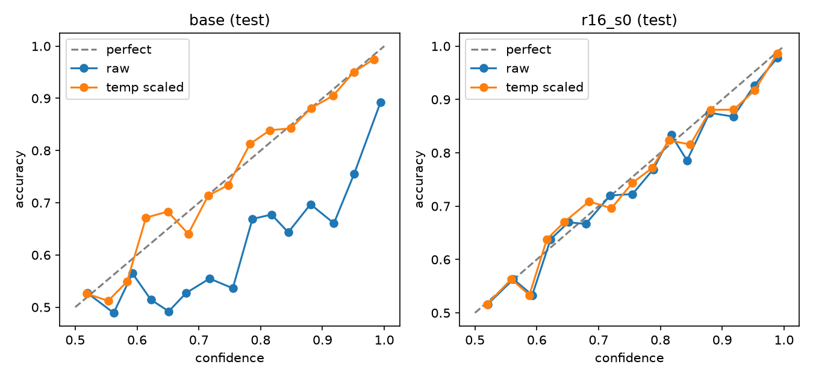

# Does fine-tuning make a VLM less confidently wrong?

LoRA fine-tune of Qwen3-VL-2B on a spatial reasoning dataset, with the
training loop and the LoRA layer written by hand, on one 8 GB GPU. The
question is not only whether accuracy goes up, but whether the model's
confidence gets more honest.

## Why

In an earlier project a VLM judged spatial statements about rendered scenes
("the cushion is left of the sofa") and I read its confidence from the yes/no
token probability. Some answers were wrong at p > 0.998. A confidence that
high is useless if it can be wrong, because a planner cannot tell when to
look again. This repo asks whether fine-tuning fixes that, or whether a much
cheaper fix does the same job.

## Setup

- **Data**: [VSR](https://github.com/cambridgeltl/visual-spatial-reasoning),
  10,972 statements about 6,259 COCO images, each labelled true or false.
- **Split**: my own, by image. In the official random split 1,226 of the
  2,195 test rows use an image that is also in train. Here no image appears
  in more than one split.

  | split | rows | images | used for |
  |---|---|---|---|
  | train | 5,324 | 3,461 | training |
  | val | 742 | 473 | picking the checkpoint, fitting the temperature |
  | test | 3,417 | 1,790 | final numbers |
  | test_unseen | 1,489 | 1,362 | five relations that never appear in training |

- **Model**: Qwen3-VL-2B-Instruct in bf16. LoRA (rank 16, alpha 32) on
  `q_proj` and `v_proj` of the language model, 3,211,264 trainable parameters
  (0.151% of the model's 2.13 billion).
- **Confidence**: p(yes) is the softmax over the `yes` and `no` logits at the
  first answer position. No text is parsed.
- **Baseline**: temperature scaling. One number fitted on val, applied to the
  base model. Fine-tuning has to beat this to be worth it for calibration.

## Results

Test set, 3,417 rows. Intervals are 95% bootstrap intervals over images.

| model | accuracy | ECE raw | ECE temp scaled | wrong at >99% confidence |
|---|---|---|---|---|
| base | 0.7556 | 0.1296 | 0.0193 | 0.0319 |
| fine-tuned (r=16) | 0.8341 | 0.0196 | 0.0165 | 0.0012 |
| difference | +0.0785 [+0.0628, +0.0933] | -0.1100 [-0.1171, -0.0897] | -0.0028 [-0.0175, +0.0104] | |

Unseen relations, 1,489 rows:

| model | accuracy | ECE raw | ECE temp scaled |
|---|---|---|---|
| base | 0.7542 | 0.1344 | 0.0335 |
| fine-tuned (r=16) | 0.7992 | 0.0456 | 0.0368 |
| difference | +0.0450 [+0.0224, +0.0672] | -0.0888 [-0.1063, -0.0634] | +0.0033 [-0.0191, +0.0252] |



What I found: fine-tuning raised test accuracy by 7.9 points [6.3, 9.3],
and by 4.5 points [2.2, 6.7] on relations it never saw in training, so part
of what it learned carries over. It also removed most of the overconfidence
on its own: raw ECE fell from 0.130 to between 0.020 and 0.048 across three
seeds, and answers wrong at over 99% confidence went from 3.2% of test to
0.1%. But for calibration alone, the cheap fix is enough. Temperature scaling
takes the base model to ECE 0.019 with no answers wrong at over 99%, and
after scaling the two models are equally well calibrated (the interval
contains 0). What fine-tuning adds is accuracy. The weak spot is unseen
relations, where the fine-tuned model stays slightly overconfident even
after scaling (0.824 confidence against 0.799 accuracy).

### Rank ablation

| run | rank | trainable params | test accuracy | test ECE raw | test ECE scaled | minutes |
|---|---|---|---|---|---|---|
| r4_s0 | 4 | 802,816 | 0.8367 | 0.0387 | 0.0252 | 57.7 |
| r16_s0 | 16 | 3,211,264 | 0.8341 | 0.0196 | 0.0165 | 55.1 |
| r16_s1 | 16 | 3,211,264 | 0.8528 | 0.0475 | 0.0253 | 52.5 |
| r16_s2 | 16 | 3,211,264 | 0.8417 | 0.0270 | 0.0192 | 54.7 |
| r64_s0 | 64 | 12,845,056 | 0.8516 | 0.0512 | 0.0273 | 64.0 |

The three rank 16 rows differ only in seed. Differences between ranks that
are smaller than the spread between those three are noise.

The seed alone moved test accuracy from 0.834 to 0.853. Rank 4 (0.837) and
rank 64 (0.852) both fall inside that range, so rank made no clear
difference. Scaled ECE is between 0.017 and 0.027 for every run. Raw ECE
moves about as much between seeds (0.020 to 0.048) as between ranks (0.020
to 0.051), so it isn't tied to the rank either. I kept rank 16 as the main
run. Rank 4 would have done as well with a quarter of the trainable
parameters. Rank 64 took 64 minutes, against 52.5 to 57.7 for ranks 4 and 16.

All the intervals above are for r16_s0, which had the lowest accuracy of the
three seeds and the lowest raw ECE. On unseen relations the other two seeds
reached 0.836 and 0.826, against 0.799 for r16_s0 and 0.754 for the base
model. They also kept the same weak spot there: ECE 0.040 after scaling.

### Fitting in 8 GB

| | peak VRAM | samples / s |
|---|---|---|
| with gradient checkpointing | 4.54 GB | 5.7 |
| without | 5.74 GB | 8.7 |

Batch size 2 with 8 accumulation steps (effective batch 16), images shrunk to
448 pixels on the long side, bf16 autocast with the LoRA weights kept in
float32. Measured over 50 optimizer steps on an RTX 5070 Laptop GPU (8 GB),
with samples / s averaged over steps 11 to 50 (the first 10 include
warm-up). Checkpointing saved 1.2 GB at the cost of about a third of the
speed. At batch size 2 the run also fits without it, so on this card it
wasn't needed. It would be for a larger batch or bigger images.

### Inference cost

| | weights | peak VRAM | median latency | p95 latency | test accuracy | test ECE |
|---|---|---|---|---|---|---|
| bf16 | 4.26 GB | 4.37 GB | 70.5 ms | 84.7 ms | 0.8338 | 0.0219 |
| 4-bit | 1.66 GB | 1.78 GB | 96.8 ms | 115.9 ms | 0.8107 | 0.0568 |

Latency is model time only, at batch size 1, over 200 test rows after 10
warm-up calls. Test ECE is raw, without temperature scaling. Both rows are
the merged model from `export/`. 4-bit cut the weights by 61% (2.6 GB), but
it was 37% slower at the median and at p95, most likely because every layer
turns its weights back into bf16 before it multiplies. It also cost 2.3
points of accuracy and made the model more overconfident: mean confidence
rose from 0.850 to 0.861 while accuracy fell, and confidently wrong answers
went from 0.12% to 0.73% of test. A 4-bit deployment would need its own
temperature, fitted on val with the 4-bit model. On an 8 GB card, where bf16
fits with room to spare, bf16 is the better choice.

## Run it

```bash
python -m venv .venv && source .venv/bin/activate
pip install -r requirements.txt

python download.py            # annotations and images, about 1 GB
python split.py
python peek.py                # sanity check before training

python evaluate.py --name base
python train.py --name r16_s0
python evaluate.py --name r16_s0 --ckpt runs/r16_s0/best.pt
python report.py --main r16_s0

./run_ablation.sh             # four more runs

python export.py --ckpt runs/r16_s0/best.pt --name r16_s0
python benchmark.py
python benchmark.py --four_bit
```

Tests (no GPU needed): `pytest tests`

## Serve it

```bash
docker build -t vsr-judge .
docker run --gpus all -p 8000:8000 -v $(pwd)/export:/model vsr-judge

curl -F "statement=The cat is on the table." -F "image=@cat.jpg" localhost:8000/judge
```

The reply has `answer`, `p_yes`, `confidence`, `p_yes_raw` and `latency_ms`.
`p_yes` has been through the temperature. `p_yes_raw` is what the model said.

## Files

| file | what it does |
|---|---|
| `config.py` | paths and hyperparameters |
| `download.py` | VSR annotations and COCO images |
| `split.py` | split by image, hold out five relations |
| `data.py` | Dataset and collate function |
| `lora.py` | LoRA layer, inject, save, load, merge |
| `utils.py` | load the model, LR schedule, read the answer logits |
| `train.py` | the training loop |
| `evaluate.py` | p(yes) for every row of a split |
| `calibration.py` | accuracy, ECE, NLL, temperature scaling, bootstrap |
| `report.py` | base vs fine-tuned, reliability plot |
| `export.py` | merge LoRA into the weights |
| `benchmark.py` | latency and memory |
| `serve.py` | FastAPI endpoint |

## Limits

- One dataset, one model size, one GPU. Nothing here says how this transfers
  to rendered scenes like the ones the original Judge saw.
- VSR labels come from annotator votes and some are arguable, so accuracy
  has a ceiling below 100%.
- ECE depends on the bin count (15 here). NLL and Brier are in
  `results/report.json` as a cross-check.
- Single GPU only. No distributed training.
