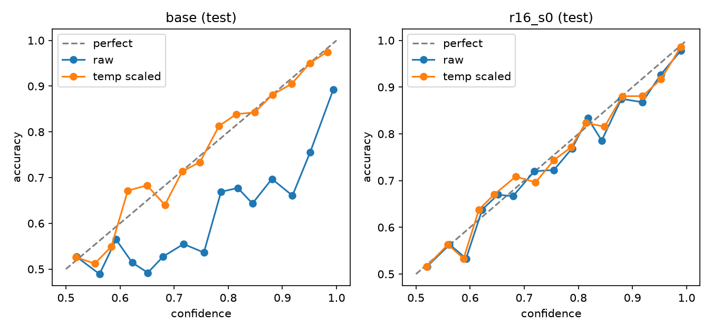

# Base vs fine-tuned (r16_s0)

## 1. Accuracy

Test: 0.7556 to 0.8341, difference +0.0785 [+0.0628, +0.0933].
Unseen relations: 0.7542 to 0.7992, difference 0.0450 [+0.0224, +0.0672].

## 2. Raw calibration

Test ECE: 0.1296 to 0.0196, difference -0.1100 [-0.1171, -0.0897]. Mean confidence went from 0.8847 to 0.8503.

## 3. After temperature scaling

T for the base model: 2.9261. T for the fine-tuned model: 1.054.
Test ECE after scaling: base 0.0193, fine-tuned 0.0165, difference  -0.0028 [-0.0175, +0.0104].

The base model's raw line sits well below the diagonal of the reliablility plot at every confidence above 0.6 (answers given at about 92% confidence were right about 66% of the time), and temperature scaling moves it onto the diagonal. The fine-tuned model's raw and scaled lines lie almost on top of each other along the diagonal, which is what a T of 1.05 looks like.

## 4. Confidently wrong, and which relations moved

Wrong at more than 99% confidence on test: base 0.0319(~109 rows), fine-tuned 0.0012 (~4 rows).

Biggest gains: +0.162 (228 rows), +0.158 (114 rows), +0.128 (70 rows).
Smallest gains or losses: -0.034 (59 rows), on top of +0.005 (207 rows), in front of +0.035 (226 rows).

## What this means

Fine-tuning raised test accuracy by 7.9 points [6.3, 9.3], and by 4.5 points [2.2, 6.7] on relations it never saw in training. It also removed most of the base model's overconfidence on its own: raw ECE fell from 0.130 to 0.020, and its fitted temperature is 1.05, against 2.93 for the base model. After temperature scaling, the two models are equally well calibrated, so the accuracy gain is the real improvement. The one blaring weak spot is unseen relations. There the fine-tuned model is still a little overconfident (0.831 confidence against 0.799 accuracy), and temperature scaling only brings its ECE from 0.046 to 0.037, against 0.017 on the relations it trained on.